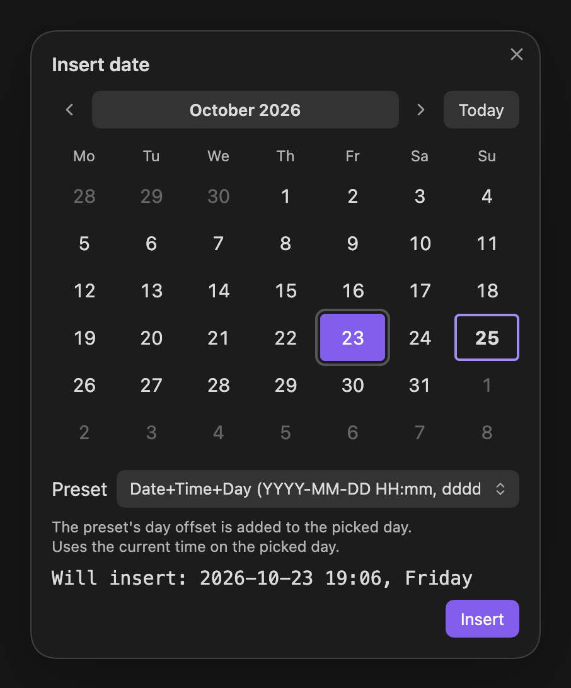

# Daystamp

Insert dates and times into your Obsidian notes in your own formats, from a calendar, a ribbon icon, commands or an inline trigger.

All four ways share the same named **presets**, so a format you set up once works everywhere.

  

## Features

- **Ribbon icon:** one click inserts your default preset.
- **Inline trigger:** type `@@` for a list of presets. `@@+3` shifts the date three days ahead, `@@-1` gives yesterday, and `@@time` filters by name.
- **Calendar:** pick any day with the mouse or keyboard, choose a preset, and see exactly what will be inserted.
- **Commands:** one per preset, for the command palette, Slash commands and hotkeys. Renaming a preset keeps its hotkey.
- **Presets:** any [moment.js format](docs/user/reference/format-tokens.md), day offsets (Tomorrow, Next week), and optional links to your daily notes, such as `[[2026-10-25|Sunday 25 October]]`.
- Works on desktop and mobile, follows Obsidian's language, and is fully keyboard and screen-reader accessible.

## Screenshots

<table>
  <tr>
    <td align="center" valign="top"> <b>Calendar</b>: pick a day, choose a preset, see the result before inserting.</td>
    <td align="center" valign="top"> <b>Preset editor</b>: format with live preview, day offset, link to daily note.</td>
  </tr>
  <tr>
    <td colspan="2" align="center"> <b>Settings</b>: manage presets, the default, the trigger and more. Every option shows up in Obsidian's settings search.</td>
  </tr>
</table>

Built-in presets: 

**Date** `2026-10-25`  
**Date+Time** `2026-10-25 14:30`  
**Date+Day** `2026-10-25 Sunday`  
**Date+Time+Day** `2026-10-25 14:30, Sunday`  
**Tomorrow** `2026-10-26`  

## Install

Daystamp needs Obsidian 1.13.0 or later. Until it's listed in the Community plugins directory, install it by hand: see [Getting started](docs/user/getting-started.md#1-install-daystamp).

## Documentation

- **Users:** start with [Getting started](docs/user/getting-started.md), then browse the [how-to guides, reference and FAQ](docs/README.md#for-users).
- **Developers:** see [CONTRIBUTING](CONTRIBUTING.md) and the [developer docs](docs/README.md#for-developers).

## Privacy

Daystamp makes **no network requests** and collects **no telemetry**. It writes only its own settings file and doesn't use the clipboard. It reads the core Daily notes date format to build links. Details: [Privacy and security](docs/user/explanation/privacy-and-security.md).

## Support

Found a bug or have an idea? [Open an issue](https://github.com/alin-morosanu/daystamp/issues). For security problems, see the [security policy](SECURITY.md).

## License

[MIT](LICENSE) © 2026 Alin Morosanu
