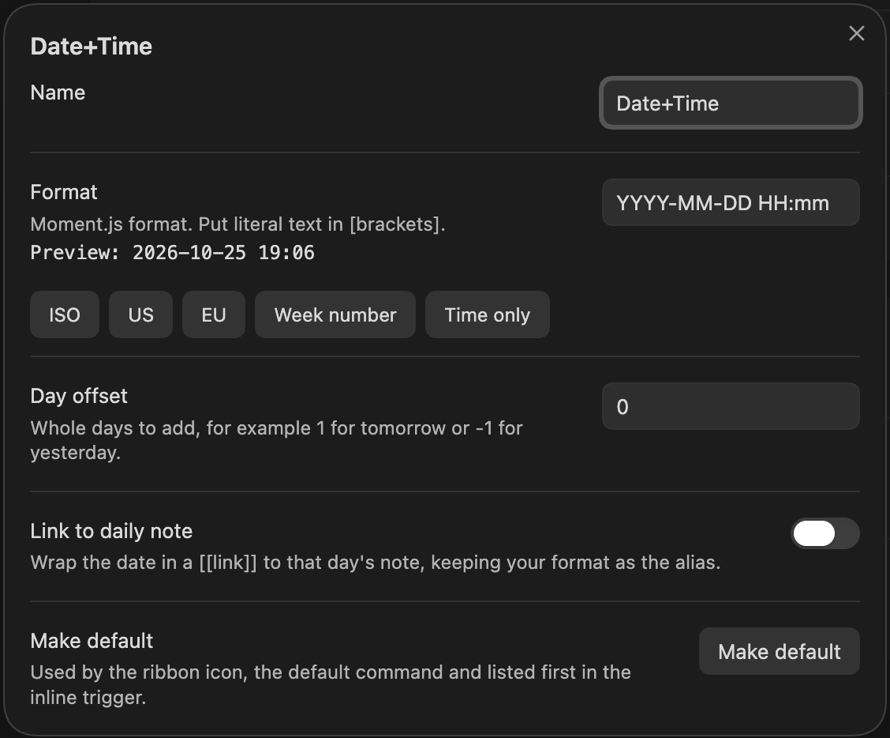

# Create a preset

A preset is a named format that every way of inserting can use. This guide adds one and makes it the default.

## Add the preset

1. Open **Settings → Daystamp**.
2. In the **Presets** list, click **+** (on mobile, tap **Add preset** under the list).

   A preset called **New preset** is added and its editor opens.
3. Change **Name** to something you'll recognise in lists, for example `Meeting`.
4. Type a **Format**, for example `dddd D MMMM [at] HH:mm`.

   The preview under the field updates as you type: `Preview: Sunday 25 October at 14:30`. Text in `[brackets]` is inserted as-is. To start from a common format, click one of the buttons under the field: **ISO**, **US**, **EU**, **Week number** or **Time only**.
5. Close the editor. Your changes are already saved.

The preset now appears in the `@@` list and the calendar, and gets its own command: **Insert Meeting (dddd D MMMM [at] HH:mm)**.

## Shift the date by whole days

To make a preset for another day, set **Day offset**. Use `1` for tomorrow, `-1` for yesterday, or `7` for a week ahead. The time of day stays the same.

The offset applies everywhere, the calendar included: a **Tomorrow** preset used on a picked Friday inserts Saturday.

## Make it the default

The default preset is what the ribbon icon and the **Insert default date** command insert, and it's listed first after `@@`.

- In the preset's editor, click **Make default**, or
- In **Settings → Daystamp**, choose it in the **Default preset** dropdown.

## Reorder or delete presets

- **Reorder:** drag a preset by its handle, or use its **up** and **down** arrow buttons.
- **Delete:** click the delete button on its row, or select the row and press **Delete**. A notice with an **Undo** button appears for 5 seconds. Undoing restores the preset with its hotkey.

You can't delete the last preset. To start over, use **Reset presets to defaults**; it can also be undone for 5 seconds.

## Related

- [Format tokens](../reference/format-tokens.md)
- [Settings reference](../reference/settings.md)
