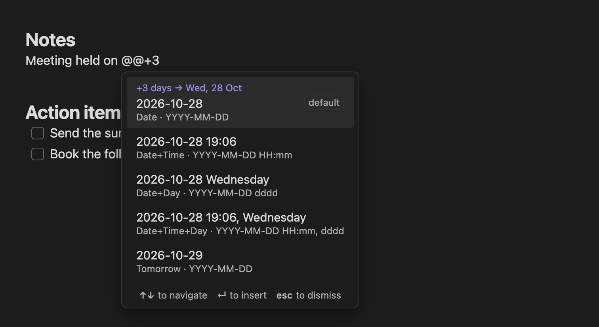

# Inline trigger

Type the trigger (`@@` by default) in a note to open a list of presets.



## Syntax

```
@@[offset][filter]
```

| You type | Result |
|---|---|
| `@@` | All presets, default first. |
| `@@+3` | All presets, three days ahead. |
| `@@-1` | All presets, yesterday. |
| `@@7` | Same as `@@+7`. |
| `@@time` | Presets whose name contains "time". |
| `@@+3 day` | Presets matching "day", three days ahead. A space between offset and filter is optional. |

- **Offset:** a whole number of days, up to 3 digits (−999 to +999). It's added to each preset's own day offset.
- **Filter:** matches preset names, ignoring case. Letters with accents work, so `@@mâine` finds a preset called "Mâine".

## The list

- Each row shows the **text that will be inserted**, with the preset name and format underneath. The default preset is marked **default**.
- With an offset, the first row also shows the target day, for example `+3 days → Wed, 28 Oct`.
- The last row, **Pick from calendar…**, opens the [calendar](calendar.md). The day you pick replaces the trigger text. If you close the calendar without inserting, the trigger text is removed.

| Key | Action |
|---|---|
| **↑ ↓** | Move through the list |
| **Enter** | Insert, replacing the trigger and everything typed after it |
| **Esc** | Close the list and keep what you typed |

## Where the trigger doesn't open

- Inside fenced code blocks.
- Inside inline code (between backticks).
- In the frontmatter.
- While composing text with an input method editor (IME), for example when typing Chinese or Japanese.

## Settings

See [Settings: Inline trigger](settings.md#inline-trigger) to change the trigger or turn it off.
