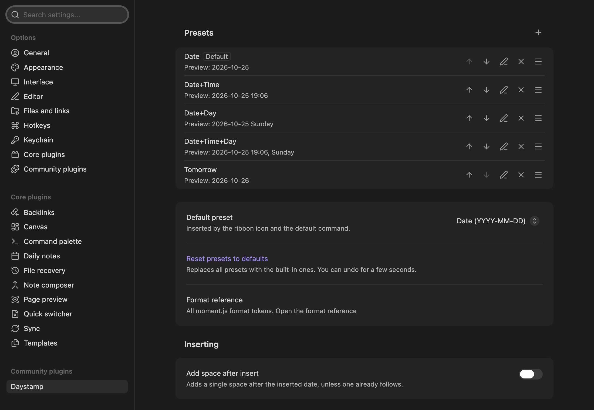

# Settings

Open **Settings → Daystamp**. Every setting can also be found through the search box in Obsidian's settings.

Changes are saved automatically, shortly after you make them and again when you close settings.

## Presets

The list of presets. Each row shows the name, a preview of what it inserts, and buttons to move it up, move it down, edit it or delete it. Drag a row to reorder.

| Field (in the preset editor) | Default for a new preset | Description |
|---|---|---|
| **Name** | New preset | Shown in lists and in the preset's command name. |
| **Format** | `YYYY-MM-DD` | See [format tokens](format-tokens.md). Can't be empty. The buttons below it fill in common formats. |
| **Day offset** | `0` | Whole days to add. Up to ±3650. |
| **Link to daily note** | Off | Insert the date as a link to that day's note. See [Link dates to daily notes](../how-to/link-dates-to-daily-notes.md). |
| **Make default** | | Makes this the default preset. |

### Built-in presets

| Name | Format | Day offset | Example |
|---|---|---|---|
| Date (default) | `YYYY-MM-DD` | 0 | 2026-10-25 |
| Date+Time | `YYYY-MM-DD HH:mm` | 0 | 2026-10-25 14:30 |
| Date+Day | `YYYY-MM-DD dddd` | 0 | 2026-10-25 Sunday |
| Date+Time+Day | `YYYY-MM-DD HH:mm, dddd` | 0 | 2026-10-25 14:30, Sunday |
| Tomorrow | `YYYY-MM-DD` | 1 | 2026-10-26 |

You can have up to 50 presets.

| Setting | Default | Description |
|---|---|---|
| **Default preset** | Date | Inserted by the ribbon icon and the **Insert default date** command, and listed first after the trigger. |
| **Reset presets to defaults** | | Replaces all presets with the built-in ones. You can undo for 5 seconds. |
| **Format reference** | | Link to the full list of moment.js format tokens. |

## Inserting

| Setting | Default | Description |
|---|---|---|
| **Add space after insert** | Off | Adds one space after the inserted text, unless a space already follows. |

## Inline trigger

| Setting | Default | Description |
|---|---|---|
| **Enable inline trigger** | On | Turns the trigger list on or off. |
| **Trigger** | `@@` | 1 to 5 characters, no spaces. Disabled while the trigger is off. |

A **Trigger conflict** warning appears if the Natural Language Dates plugin is enabled and the trigger starts with `@`.

## Calendar

| Setting | Default | Description |
|---|---|---|
| **Show calendar ribbon icon** | Off | Adds a second ribbon icon that opens the calendar. |
| **First day of the week** | Follow language | Or **Sunday** or **Monday**. |

## Links

| Setting | Default | Description |
|---|---|---|
| **Link target format** | Empty (auto) | Format of daily note names for **Link to daily note**. When empty, Daystamp uses the Daily notes plugin's date format, or `YYYY-MM-DD`. The placeholder shows which one applies. |

A **Link target warning** appears if a preset links to daily notes and today's link target contains `:` `\` `#` or `^`.

## Where settings are stored

In `.obsidian/plugins/daystamp/data.json` inside your vault. If you sync your vault, changes made on another device are picked up without restarting.
